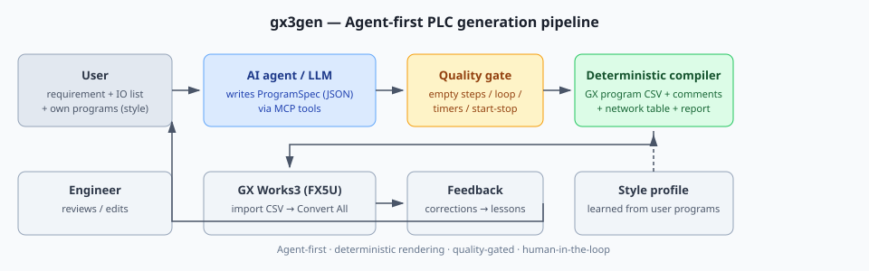

# gx3gen — 三菱 GX Works3 PLC AI 编程工具包

[English](README.en.md) | **中文**

> **第一次使用？** 先看 [START_HERE.md](START_HERE.md)：下载后 5 分钟跑通一次示例。
> **不需要 API Key、不需要打开网页、不强制配置 MCP。**

> 面向 **三菱 FX5U + GX Works3 1.082** 的 agent-first PLC 编程工具包：
> 把「中文需求 + IO 表 + 你自己的编程风格」变成一版**可读、可改、可在 GX Works3 导入**的
> 设备段 + SFC(STL) 梯形图程序初稿（程序本体 CSV + 软元件注释 CSV + 网络表 + 生成报告）。

[](https://www.python.org/)
[](#环境要求)
[](#测试)
[](run_mcp.py)
[](LICENSE)

**推荐用法：下载/克隆本仓库 → 用 AI agent（Claude Code / DeepSeek Harness / Cursor / Codex…）打开 →
（可选）把 agent 连到内置 MCP server → agent 自己写 `ProgramSpec`、校验、生成 CSV 并汇报结果。
用户只需要用中文描述需求、提供 IO 表。MCP 配不上时，agent 也能直接用 CLI 完成。**

> **第一次使用请先看 [START_HERE.md](START_HERE.md)**：从跑通示例到 GX 导入的完整上手流程。

> **不需要 API Key。** 打开仓库的 AI 编程工具本身自带模型，它才是"写程序的 AI"；
> 本项目不内置 LLM 调用，只提供契约（ProgramSpec）、工具（MCP/CLI）、质量门槛和确定性编译器。
> 「设置」里的 LLM 配置仅用于可选的独立 Web/CI 模式，agent 模式完全不需要。

> AI **不直接写 GX CSV/二进制**：它产出结构化 `ProgramSpec`，由确定性编译器渲染官方 GX Works3 CSV；
> 质量门槛会拦截"一两个空 STL 步"这类垃圾结果。编译错误与最终逻辑由工程师在 GX Works3 接手完成。

---

## 核心特性

| 层 | 文件 | 作用 |
|---|---|---|
| **Agent 接入** | [`AGENTS.md`](AGENTS.md)、[`skills/gx3gen-plc/`](skills/gx3gen-plc/)、[`run_mcp.py`](run_mcp.py) | MCP server（17 个工具）+ 技能包 + agent 手册，适配任意支持 MCP 的 AI 客户端 |
| **规划层** | [`src/gx3gen/planner/`](src/gx3gen/planner/) | 规则解析 / 领域模板；项目内 LLM 只是**可选独立适配器**（agent 模式不使用） |
| **质量门槛** | [`src/gx3gen/quality.py`](src/gx3gen/quality.py) | 结构检查 + 需求红线；不合格不生成 |
| **GX 导入自检** | [`src/gx3gen/audit.py`](src/gx3gen/audit.py)、[`tools/gx_audit.py`](tools/gx_audit.py) | 生成后/导入前检查 BOM、行尾、操作数个数、IL 序列、STL-RETSTL、注释标题 |
| **手册知识库** | [`src/gx3gen/manual/`](src/gx3gen/manual/)、[`docs/MANUALS.md`](docs/MANUALS.md) | 官方/用户手册 → 本地 FTS5 索引 → agent 按需查片段（手册/章节/页码）；不把整本 PDF 塞进上下文 |
| **领域模板** | [`src/gx3gen/domains.py`](src/gx3gen/domains.py) | 内置双向红绿灯（6 相位/6 定时器/自动循环/启停） |
| **确定性编译器** | [`src/gx3gen/generator/`](src/gx3gen/generator/)、[`src/gx3gen/ilcsv/`](src/gx3gen/ilcsv/) | `ProgramSpec` → 段/STL → IL → 官方 GX CSV（UTF-16LE+BOM、TAB、QUOTE_ALL、CRLF、7 列、END） |
| **风格学习** | [`src/gx3gen/style/`](src/gx3gen/style/) | 从你 GX 导出的程序/注释 CSV 学段结构、步号段、模式位、报警基址、握手命名 |
| **反馈闭环** | [`src/gx3gen/feedback/`](src/gx3gen/feedback/) | 用户纠错 → lessons / checklist / prompt hints → 下一轮生成自动规避 |
| **本地 Web UI（实验性）** | [`src/gx3gen/app/`](src/gx3gen/app/)、[`web/`](web/) | **非主流程**：可选审阅/可视化/产物浏览；纯对话模式不需要打开，也不需要 API Key |
| **CLI** | [`src/gx3gen/cli.py`](src/gx3gen/cli.py)、[`run.py`](run.py) | 批量、回归、集成 |



---

## 环境要求

- Windows，实际导入/编译需要安装 **GX Works3 1.082**（仅生成程序不需要）
- **Python 3.9+**，**零第三方依赖**（只用标准库；不需要 pytest）
- 推荐 agent 方式时：任意支持 MCP 的 AI 客户端

---

## 快速开始

```bash
git clone https://github.com/mlwei1/liu-ai-gxworks3.git
cd liu-ai-gxworks3
python -m unittest discover -s tests -t .     # 167 个测试，无网络
```

### A. AI Agent + MCP（推荐）

1. 用 AI agent 打开本仓库。agent 会自动读取 [`AGENTS.md`](AGENTS.md) 与
   [`skills/gx3gen-plc/SKILL.md`](skills/gx3gen-plc/SKILL.md)。
2. 按 [`mcp.json.example`](mcp.json.example) 把 MCP server 配进 AI 客户端：

   ```json
   {
     "mcpServers": {
       "gx3gen": {
         "command": "python",
         "args": ["<仓库绝对路径>/run_mcp.py"],
         "env": { "GX3GEN_WORKSPACE": "<仓库绝对路径>/workspace" }
       }
     }
   }
   ```

3. 对 agent 说人话即可，例如：

   > 做一个双向红绿灯：东西/南北各三灯，启动后自动循环，东西绿 10s → 黄 3s → 全红 1s →
   > 南北绿 10s → 黄 3s → 全红 1s；停止按钮复位所有灯。

   agent 会：`gx3gen_get_generation_context` → 自己写 `ProgramSpec`
   →（可选）`gx3gen_create_project` + `gx3gen_save_spec` 保存到 workspace
   → `gx3gen_validate_spec` → 按 `quality.errors` 迭代 → `gx3gen_generate_program`
   → 汇报产物、质量、assumptions 与 GX 落地步骤。
4. agent 会就不清楚的工艺/IO/互锁**问你**；不会凭空发明设备号。
5. 纯对话即可完成全部流程；**不需要打开 Web 界面**。若想人工审阅/对比/下载，可选启动实验性 Web 界面，它会读取 agent 写入的同一份 `workspace/projects/<id>/spec.json`。

MCP 工具：

| 工具 | 用途 |
|---|---|
| `gx3gen_get_generation_context` | 必读上下文：ProgramSpec/架构默认/质量红线/示例/IO/风格/lessons |
| `gx3gen_validate_spec` | 结构校验 + 质量门槛 |
| `gx3gen_generate_program` | 生成 4 个产物（程序 CSV、注释 CSV、网络表、报告），并自动做 GX 导入自检 |
| `gx3gen_audit_csv` | 导入前自检（格式/操作数/IL/STL/注释标题），可复核外部 CSV |
| `gx3gen_manual_list/toc/search/read` | 手册知识库：先查目录/检索片段，再按需读章节；不把整本 PDF 塞进上下文 |
| `gx3gen_create_project` / `gx3gen_save_spec` / `gx3gen_load_spec` / `gx3gen_list_projects` | 项目与 `spec.json` 文件交接（agent 与 Web 共用 workspace） |
| `gx3gen_get_examples` | 红绿灯 / 三工位示例 |
| `gx3gen_list_styles` / `gx3gen_import_style` | 管理从你 GX CSV 学到的风格画像 |
| `gx3gen_add_feedback` / `gx3gen_get_lessons` | 反馈闭环 |

> MCP 工具集里**没有**项目内 LLM/规划工具：agent 自己就是规划器，MCP 不读 API Key、不联网。

完整对话流程（含导入风格/纠正/落地）见 [docs/CHAT_WORKFLOW.md](docs/CHAT_WORKFLOW.md)；
更细的协议级示例见 [docs/AGENT_WORKFLOW.md](docs/AGENT_WORKFLOW.md)。

### B. CLI（没有 MCP 时的兜底）

```bash
python run.py plan --req samples/traffic_light.requirement.md --io samples/traffic_light.io.csv --out out/spec.json
python run.py gen  --spec out/spec.json --out ./out-demo
python run.py audit --program ./out-demo/program.csv --comments ./out-demo/comments.csv
python run.py style import --program-csv "程序本体.csv" --comment-csv "全局软元件注释.csv" --name "我的风格"
```

> `plan` 默认使用规则/领域模板；`plan --llm` 是可选的非 agent 模式。agent 模式下由 agent 自己产出
> ProgramSpec，不需要 Key。

### C. 手册知识库（查手册，不读整本 PDF）

```bash
# 建索引（仅建索引需要可选 PyMuPDF；查询只用标准库）
python -m pip install -r requirements-manuals.txt
python run.py manual add --path "docs/官方资料/你的手册.pdf" --model FX5U

# 查
python run.py manual list
python run.py manual search "SET 操作数"
python run.py manual toc <manual_id>
python run.py manual read <manual_id> --section 1234
```

- 官方/公司手册不要提交 git（`.gitignore` 已忽略 `docs/官方资料/` 与 `workspace/`）；
- agent 通过 `gx3gen_manual_list/toc/search/read` 按需查，回答引用 **手册/章节/页码**；
- 索引/隐私/限制见 [docs/MANUALS.md](docs/MANUALS.md)。

### D. 实验性：本地 Web 审阅界面（非主流程）

> **主流程不需要它，也不需要打开网页。** 这一层仅用于人工审阅/对比/下载/记录反馈；
> 如果只想走纯对话，可以完全不启动、后续也可以移除。

```bash
python run.py serve          # 浏览器打开 http://127.0.0.1:8765
python run.py seed-demo      # 创建一个三工位示例项目
```

- 打开 agent 创建的项目即可审阅 spec、生成结果、下载 CSV、记录反馈；不需要任何 API Key。
- 需求/IO 输入和「规则解析」保留作离线兜底；「本地 LLM」是可选的独立模式。
- 页面上会显示"实验性"提示；它不是产品主入口。

---

## 工作原理

```
需求 + IO 表 + 风格画像
        │
        ▼  AI agent（你的 AI 编程工具，自带模型）产出 ProgramSpec（JSON，人可读可改）
        ▼  质量门槛（自动流程 / 循环 / 定时 / 启停 / 红绿灯相位 …）
        ▼  确定性编译器 → GX 程序本体 CSV + 软元件注释 CSV + 网络表 + 报告
        ▼  GX 导入自检（操作数/IL/STL/注释格式）→ audit.ok
工程师在 GX Works3：导入 CSV → 全部转换 → 修编译错误/补逻辑 → 保存
```

- **Agent 是唯一大脑**：项目不内置 LLM 主路径，不需要 API Key；agent 通过 MCP 获取契约/上下文并写 spec。
- **规划与渲染分离**：agent/LLM 只写 JSON，格式由编译器保证。
- **质量门槛**：结构不完整或明显不合需求（如"只有 1 个空步"）直接拒绝生成。
- **领域模板**：双向红绿灯等常见需求无需任何模型也能生成完整自动流程。
- **风格学习**：生成会遵循你的段结构、步号段、命名、握手习惯；**反馈**会进入下一轮。
- **本期不做仿真/自动编译验收**：生成物是初稿，由工程师接手。

### 示例：双向红绿灯（规则模板，无 LLM、无风格）

输入 [`samples/traffic_light.requirement.md`](samples/traffic_light.requirement.md)，输出：

```
3 段 / 28 网络 / 92 指令 / 约 261 步
[Title]初始化 → [Title]启动停止 → [Title]自动流程
6 个 STL 相位 S10–S60 + 6 个定时器（K250/K30/K20/K200/K30/K20）
6 个 STL 步块各配 1 个 RETSTL；末步回到 S10 形成自动循环；quality.ok = true；audit.ok = true
```

对应 ProgramSpec 见 [`samples/traffic_light.spec.json`](samples/traffic_light.spec.json)。

---

## GX Works3 落地步骤

1. 确认生成结果的 `audit.ok=true`；需要复核时运行：
   `python run.py audit --program <program.csv> --comments <comments.csv>`。
2. 打开一个**基座工程副本**（FX5U，已有 MAIN 程序）。
3. 打开 MAIN 程序本体，光标放在程序内（不要停在 `END` 行）。
4. `[编辑] → [导入文件]`，选择生成的 `program.csv`。
5. 在软元件注释窗口导入 `comments.csv`（注释 CSV 必须是 LF 行尾，标题与目标工程一致）。
6. `全部转换`（Shift+Alt+F4），修编译错误/补逻辑，保存。

> 2026-10-28 实测：按上述约束生成的程序本体 + 注释已在 GX Works3 1.082 导入成功。
> 常见失败原因与定位方法见 [docs/GX_IMPORT_TROUBLESHOOTING.md](docs/GX_IMPORT_TROUBLESHOOTING.md)。
> 官方限制：CSV 导入只能**替换已存在的程序本体**（不能新建 POU/程序），必须以 `END` 结尾，
> 导入后程序处于"未转换"状态；导入是整段替换，请务必先备份/用副本工程。

---

## 目录结构

```
.
├── START_HERE.md / .en.md    # 新手上路：下载后 5 分钟跑通
├── AGENTS.md                 # AI agent 操作手册（铁律/工作流/质量红线/工具表）
├── README.md / README.en.md  # 中文 / English
├── run.py / run_mcp.py       # CLI 入口 / MCP stdio 入口
├── mcp.json.example          # MCP 客户端配置模板
├── skills/gx3gen-plc/        # Agent 技能包（触发词/路由/字段说明/质量清单）
├── docs/                     # 架构、产品闭环、CSV 格式、agent 工作流、实现状态…
├── spec/                     # ProgramSpec / StyleProfile JSON Schema
├── samples/                  # 三工位 + 双向红绿灯示例
├── src/gx3gen/               # Python 包（planner/generator/ilcsv/style/feedback/manual/app/mcp）
├── web/                      # 实验性单页审阅界面（无构建、无 CDN；非主流程）
├── tests/                    # 167 个 unittest
└── workspace/                # 运行时数据（项目/风格/产物，已 gitignore）
```

## 测试

```bash
python -m unittest discover -s tests -t .
# Ran 167 tests ... OK
```

覆盖：GX CSV 编码/引号/续行/END、ProgramSpec 校验（含 SET/RST 操作数、LD/LDI 序列、注释标题）、
生成器段/STL/注释表、GX 导入自检、风格画像、反馈 lessons、红绿灯领域模板与质量门槛、HTTP API、
MCP 协议/工具测试。

### 可选：非 agent 模式（独立 Web / CI）

只有**不用 AI agent** 时才需要这些：

- Web「设置」里的本地 LLM 接口（OpenAI 兼容）——可选，仅存本机；
- CLI `python run.py plan --llm`。

两者共用 `planner/llm.py`（可选 standalone 适配器）。**agent 主路径不使用、不读取该配置、不需要 API Key。**

## 状态与边界

- 目标：**FX5U / GX Works3 1.082**、单 MAIN POU、软元件 + 注释、设备段 + STL。
- 未实现：标签/FB/ST/FBD/SFC 图、多机型、仿真、自动 GX 编译验收。
- 生成物是**初稿**，assumptions 必须由工程师复核。
- **真实 GX 导入已实测通过**：2026-10-28 压装测试台项目 `program.csv` + `comments.csv`
  在 GX Works3 1.082 导入成功；全部转换后的编译错误/细节逻辑仍由工程师处理。
  排障与硬约束见 [docs/GX_IMPORT_TROUBLESHOOTING.md](docs/GX_IMPORT_TROUBLESHOOTING.md)。
- 质量门槛是启发式检查，能挡明显垃圾，不证明逻辑正确；生成后还会跑 GX 导入自检。

## 更多文档

- [START_HERE.md](START_HERE.md) — **新手上路：下载后 5 分钟跑通**
- [AGENTS.md](AGENTS.md) — agent 操作手册
- [docs/CHAT_WORKFLOW.md](docs/CHAT_WORKFLOW.md) — **纯对话主流程**（生成/学风格/纠正/落地）
- [docs/AGENT_WORKFLOW.md](docs/AGENT_WORKFLOW.md) — 完整示例会话 + MCP 配置
- [docs/ARCHITECTURE.md](docs/ARCHITECTURE.md) — 架构
- [docs/PRODUCT_LOOP.md](docs/PRODUCT_LOOP.md) — 产品闭环
- [docs/CSV_FORMAT.md](docs/CSV_FORMAT.md) — GX Works3 CSV 格式
- [docs/GX_IMPORT_TROUBLESHOOTING.md](docs/GX_IMPORT_TROUBLESHOOTING.md) — GX 导入排障复盘
- [tools/gx_audit.py](tools/gx_audit.py) — GX 导入前自检
- [docs/STYLE_LEARNING.md](docs/STYLE_LEARNING.md) — 风格画像
- [docs/FEEDBACK_LOOP.md](docs/FEEDBACK_LOOP.md) — 反馈闭环
- [docs/INTERFACES.md](docs/INTERFACES.md) — 模块接口
- [docs/STATUS.md](docs/STATUS.md) — 实现状态
- [docs/MANUALS.md](docs/MANUALS.md) — 手册知识库（索引/查询/隐私/限制）

## 协议

本项目采用 **MIT License**，详见 [LICENSE](LICENSE)。

Copyright (c) 2026 mlwei1

